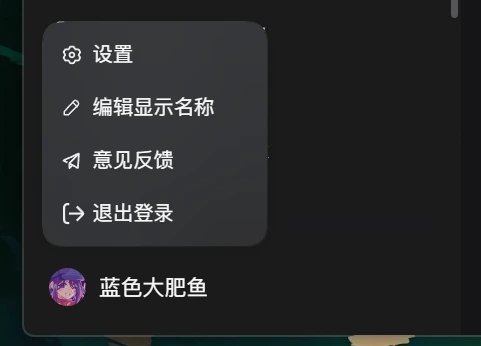
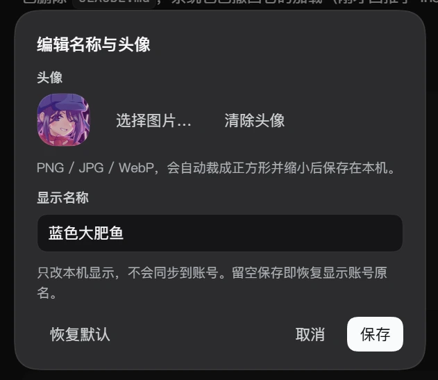

# dsh-accountdisplayname-edit

把 DeepSeek Harness 侧边栏左下角的账号文字（手机号 / 邮箱 / 账户名）**和上面的头像**
替换为你自定义的名称和图片，避免截图泄露隐私。

编辑入口就在账号菜单里：点左下角账号 → **编辑显示名称**。弹窗里同时可以改名和换头像。

## 功能

- 侧边栏左下角的账号标签改为你设置的自定义文本。
- 头像可以换成你从本地选的图片。
- 账号菜单中新增一行 **编辑显示名称**，位于「设置」下方。
- 以上两项在同一个弹窗里编辑：选择 / 清除头像、输入名称，然后 保存 / 取消 / 恢复默认。
  `Enter` 保存，`Esc` 取消。
- 两项都是**草稿**，点「保存」才生效；点「取消」侧边栏不会有任何变化。
- 名称留空保存即恢复账号原名；清空头像即恢复账号原头像。
- 选中的图片会先居中裁成正方形、缩放到 128×128 再重新编码，存储体积通常只有几十 KB。
- 名称和头像都按浏览器存在 `localStorage`：
  `dsh.account-display-name-edit.alias` 与 `dsh.account-display-name-edit.avatar`。
- **只改显示**：不读取也不修改账号、凭证与资料，插件自身不发任何网络请求。

## 环境要求

在 DSH `0.2.0-rc.2` 上开发并验证。它依赖的账号行与 `Menu` 结构——`data-signed-out`、
`_avatar` / `_label` 两个 span、portal 到 `<body>` 的 `div[role="menu"]` 及其
`role="presentation"` 视口与 `itemIcon` / `itemLabel` 行——在 `0.2.1-rc.2` 中**未变**，
本包也对照该版本核对过。宿主侧不 import 任何模块，浏览器侧失败即降级，所以在结构
已变化的版本上表现为「不覆盖、菜单里没有这一行」，而不是报错——详见[兼容性](#兼容性)。

## 安装

### 桌面版内安装

`desktop` profile 由 Electron 应用独占管理，CLI 会明确拒绝该 profile。
请通过应用自身的插件入口安装（设置 → 插件，或 `dshmarket`）。

### 其他 profile（命令行）

```sh
dsh plugin --profile <profile> add github:AomiRaku/dsh-accountDisplayName-edit
```

**没有构建步骤，也没有 `prepare` 脚本**：浏览器侧 bundle 已作为 `lib/client.js`
提交，所以 pnpm 不会要求构建授权，安装就是一次普通文件拷贝。

### 手工安装（上面两条命令做的就是这件事）

1. 把包放到 profile 能解析的位置：
   `<DSH_HOME>/profiles/<profile>/node_modules/dsh-accountdisplayname-edit`
   （指向本地 checkout 的目录联接 / 软链接也可以）。
2. 在 `<DSH_HOME>/profiles/<profile>/cordis.patch.yml` 追加：

   ```yaml
   - insert:
       - id: account-display-name-edit
         name: dsh-accountdisplayname-edit
   ```

   该 patch 层被监听，改完立即生效，**不需要重启**。

## 使用

1. 点击侧边栏底部的账号行。
2. 选择 **编辑显示名称**。
3. 想换头像就点 **选择图片…** 选一张 PNG / JPG / WebP，圆形预览会显示裁剪结果；
   点 **清除头像** 回到账号原头像。
4. 输入想要的名称。留空保存即恢复账号原名。
5. 点 **保存**。没点之前不会有任何变化。

## 截图

账号菜单：**设置** 下面多了一行 **编辑显示名称**，下方账号行显示自定义的名称与头像。



编辑弹窗：头像预览、名称输入框，以及「恢复默认 / 取消 / 保存」。



## 卸载

删掉 `cordis.patch.yml` 里那两行 insert，再删除包目录即可。
`localStorage` 里的名称和头像会留在浏览器上直到你清掉；插件不写任何其他地方。

## 实现说明

双面（dual-face）插件，逻辑几乎都在浏览器侧。

- **宿主侧 `lib/index.js`**：故意不 import 任何模块。它的唯一作用是作为 Loader
  条目存在，好让宿主的 client-module 扫描器读到 `package.json` 的 `dsh.client`
  声明并把 `./client` 发给浏览器。没有 `dependencies` 也没有 `peerDependencies`，
  所以不会因为 peer 包缺失、改名或版本不匹配而加载失败。
- **浏览器侧 `lib/client.js`**：手写的单文件 bundle，已经是模块系统原样下发的
  `window.__ModuleLoader__.load({ id, factory })` 形式，**不需要构建**。
  只 `require("react")`，而 shell 把 `react` 作为平台模块预置——这也是它不作为
  依赖声明的原因。

### 为什么菜单那一行要动 DOM

账号菜单由 `@deepseek-ai/dsh-client-ui-settings-account` 渲染，`items` 是硬编码数组；
它唯一的插槽 `settings.launcher` 是 `single` 类型，占用它会把
「设置 / 意见反馈 / 退出登录」整块替换掉——这是不能做的。而菜单项并没有可插入的插槽。

所以插件把新行追加到**已打开**菜单的列表里，并且**克隆一条已发售的行**再改文字和图标，
从而继承当前版本的确切结构、类名与样式。只增加一个节点，React 自己的 children 不受影响；
菜单卸载时这一行随之消失，因为 React 从未跟踪它。

选择器只用稳定标识，不依赖会随构建变化的 CSS Modules 哈希前缀：

- 触发器：`button[aria-haspopup="menu"][data-signed-out]`（该组件始终写入的属性）；
  文本节点优先用 `_label` 后缀、头像优先用 `_avatar` 后缀，两者都有位置退化方案。
- 菜单：`Menu` 原语 `createPortal` 到 `<body>` 的 `div[role="menu"]`，
  以「在触发器被激活之后新出现的那一个」确认。

### 头像怎么换的

头像 span 里装的是 React 自己的节点（一张 `` 或首字母）。插件**不删除**它们，
而是把选中的图片画成该 span 的**背景图**，再用一条作用域规则把子节点隐藏：

```css
[data-dsh-accountdisplayname-edit-avatar="1"] > * { display: none !important }
```

也就是说只写两个属性 + 一个背景图，没有任何 React 拥有的节点被移除、搬移或替换，
因此之后的账号刷新不会与它冲突。清除头像时移除该属性与背景图，原头像自然重现。

### 失败即降级

所有 DOM 探测都在 `try`/`catch` 内；探测落空时插件什么都不做——不会改动其他节点，
也不会向插件加载器抛错。清空名称时会把账号插件原本的文本原样还回去。

文本写入复用 React 自己的文本节点（改 `nodeValue` 而非 `textContent`），
这样后续账号资料刷新仍可被观察到，不会出现「React 更新了一个已脱离文档的节点」的问题。

## 兼容性

- 必须保留 `dsh.client.immediately: true`：插件靠 bundle 实例化时注册的副作用工作，
  因此需要在 boot 图的 immediate 层。
- **刻意不声明 `engines.dsh`**。node-semver 只有在范围里「某个比较符与该版本的
  `major.minor.patch` 元组完全一致、且自身带预发布标签」时才放行预发布版本，
  所以任何范围都会静默排除 harness 之后的预发布版本——这正是 awesome-dsh-plugin
  贡献指南警告的失败模式。这里选择「失败即降级」这个更稳妥的约定。

## 验证

```sh
npm install
npm test
```

真实 DOM 上 116 项检查（jsdom + React 18.3.1）：

- `test/dom.test.mjs` —— 40 项：bundle 包装契约、`apply()` 注册、别名替换、
  账号侧重渲染后重新覆盖、菜单行注入（文字 / 图标 / 去掉快捷键 / 插入位置 /
  不动原有行）、点击行关菜单并开弹窗、保存与恢复默认、卸载清理。
- `test/robustness.test.mjs` —— 16 项失败即降级路径：账号行整体消失、
  `_label` 类名改名、折叠态（头像 span 是唯一 span）、英文 locale、
  菜单先渲染而菜单项尚未出现、没有 `document.body`、账号 span 被 React 整体替换、
  账号行已移除后再卸载。
- `test/avatar.test.mjs` —— 28 项：已存图片绘制到账号行、作用域样式表、原头像节点保持
  完整、弹窗里的文件选择与选择/清除控件、「草稿 vs 保存」语义、未登录（没有头像 span）
  的账号行、损坏的存储值、以及卸载清理。**选文件这一步本身没有自动化**：jsdom 没有
  2D canvas，也不会解码图片。
- `test/edge-cases.test.mjs` —— 32 项失效与卸载路径：菜单轮询两帧之间被执行卸载、
  弹窗打开时被禁用后再启用、浏览器拒绝写入名称、折叠轨展开前后、重复卸载、重新挂载、
  菜单通过触发器自身的开关关闭（而不是派发全局 Escape）、弹窗的 Tab 收束与矮窗口滚动、
  点击路径**零全文查询**，且菜单打开那一帧保持原样、注入行在其后补上、以及被 React 重建的文字节点／头像节点／
  整个触发器按钮都在下一帧之前被重新绘制（不闪一帧）、以及被菜单重渲染丢掉的注入行
  在下一帧之前被补回。

另外在运行中的 DSH `0.2.0-rc.2` 上验证：宿主条目达到 `fiberPhase: active`，
正在运行的 Web GUI 插槽树把本插件的 `shell.overlay` 条目标为 active，
说明宿主成功下发 bundle、页面已实例化并执行。

## 商店收录

awesome-dsh-plugin 的收录条目已经写好，直接复制即可：

```text
store-entry/data/plugins/AomiRaku__dsh-accountDisplayName-edit.yml
  -> data/plugins/AomiRaku__dsh-accountDisplayName-edit.yml
```

把这一个文件加到 [awesome-dsh-plugin](https://github.com/awesome-dsh-plugin/awesome-dsh-plugin)
的 fork 里就是完整投稿——**不要手工编辑生成出来的 README**。

截图在 `package.json` 旁边的 [`screenshots.json`](screenshots.json) 里声明，按展示顺序
列出两张仓库内图片。图片就在本仓库，换图推这里即可，不用再向列表提 PR。

```json
["assets/screenshot-1.png", "assets/screenshot-2.png"]
```

## 已知限制

- 菜单那一行与头像覆盖都依赖账号菜单的 DOM 结构。若未来版本重构它，对应部分会静默失效
  ——不会报错，但在本包跟进之前那一行或头像不再更新。
- 名称与头像存在当前浏览器的 `localStorage`，按 origin 隔离，不跨机器同步，
  也永远不会写回账号。
- 头像以 128×128 的 PNG data URL 存储。超过 10 MB 的文件、或编码后仍超出存储上限的，
  会给出提示而不是静默丢弃。
- 只内置简体中文与英文文案；界面跟随客户端 locale，缺省回落到中文。

## 许可证

MIT
